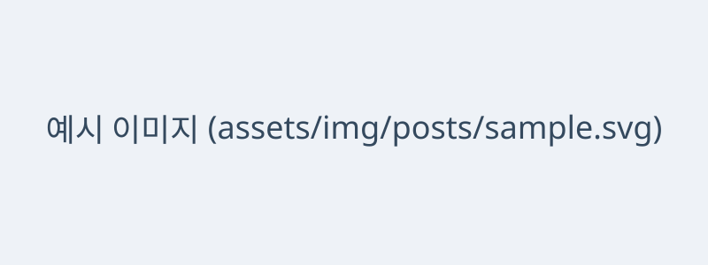

---
# ─────────────────────────────────────────────
# Front matter: 글의 정보(제목, 날짜, 분류)를 적는 부분입니다.
# 위아래의 --- 줄은 지우면 안 됩니다.
# ─────────────────────────────────────────────
title: "블로그 글 작성법 예시"            # 글 제목
date: 2026-11-26 15:00:00 +0900          # 작성 시각 (+0900 = 한국 시간)
categories: [개발, 블로그]               # 카테고리: [대분류, 소분류] 최대 2단계
tags: [jekyll, chirpy, markdown]         # 태그: 여러 개 가능, 영어 소문자 권장
# pin: true                              # 주석을 풀면 첫 화면 맨 위에 고정
# image:                                 # 목록과 글 상단에 보일 대표 이미지
#   path: /assets/img/posts/sample.svg
#   alt: 대표 이미지 설명
---

이 글은 새 글을 쓸 때 참고하라고 만든 예시입니다. 파일 위치는 `_posts/2026-11-26-how-to-write-post.md`{: .filepath } 입니다.
필요 없어지면 이 파일을 지우면 됩니다.

## 1. 제목과 문단

`## 제목`처럼 `#` 개수로 제목 크기를 정합니다. `##`와 `###`은 오른쪽 목차에도 표시됩니다.

문단은 빈 줄로 구분합니다. **굵게**, *기울임*, [링크](https://github.com/arahann)도 쓸 수 있습니다.

## 2. 코드 블록

백틱 3개(```) 뒤에 언어 이름을 적으면 문법 색상이 들어갑니다.

```python
# 간단한 수익률 계산 예시
buy_price = 50000    # 매수가
sell_price = 56000   # 매도가

rate = (sell_price - buy_price) / buy_price * 100
print(f"수익률: {rate:.1f}%")   # 수익률: 12.0%
```

프롬프트처럼 문법 색상이 필요 없는 글은 `text`로 적습니다.

```text
너는 투자 분석가야. 아래 종목의 최근 실적을 3줄로 요약해줘.
```

## 3. 표

| 종목 | 매수가 | 현재가 | 수익률 |
| :--- | ---: | ---: | ---: |
| A전자 | 50,000 | 56,000 | +12.0% |
| B화학 | 120,000 | 114,000 | -5.0% |

`:---`는 왼쪽 정렬, `---:`는 오른쪽 정렬입니다.

## 4. 이미지

이미지 파일은 `assets/img/posts/`{: .filepath } 폴더에 넣고 아래처럼 불러옵니다.

{: width="800" height="300" }
_이미지 아래 기울임 줄은 사진 설명(캡션)이 됩니다._

## 5. 강조 상자

> 팁을 적을 때 쓰는 상자입니다.
{: .prompt-tip }

> 주의할 내용을 적을 때 쓰는 상자입니다.
{: .prompt-warning }
